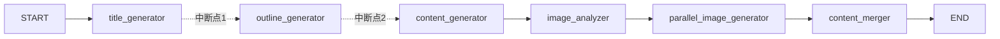
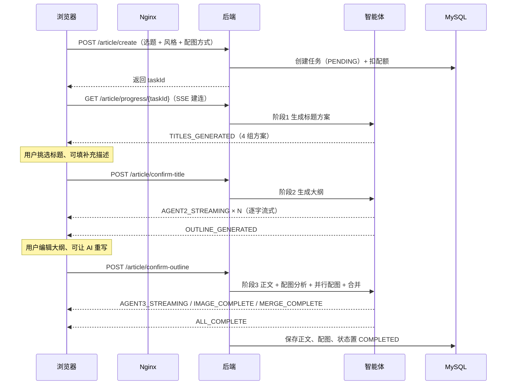
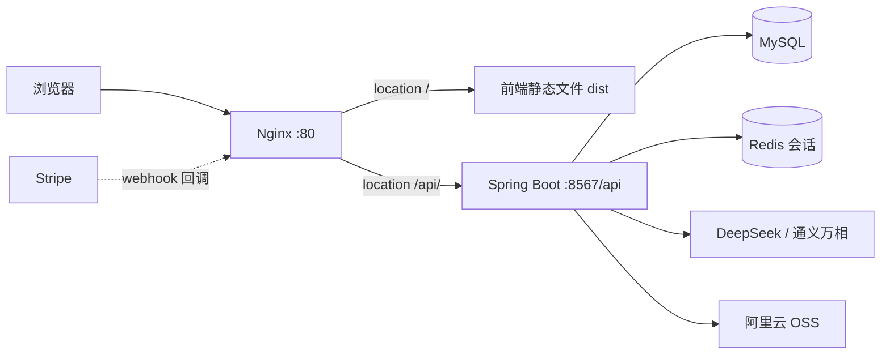

# AI Passage Creator

> 一个「人机协作」的 AI 图文创作平台：输入选题，三个 AI 智能体依次产出标题方案、文章大纲、正文与配图，
> 全过程通过 SSE 实时推送，并在关键节点让人介入决策。

基于 Spring Boot 3 + Spring AI Alibaba + Vue 3 的个人技术实践项目。

**技术栈**：Spring Boot 3.5 · Java 21 · Spring AI Alibaba · MyBatis-Flex · MySQL · Redis · Vue 3 · TypeScript

---

## 目录

- [核心功能](#核心功能)
- [技术栈](#技术栈)
- [系统架构](#系统架构)
- [快速开始](#快速开始)
- [配置说明](#配置说明)
- [接口一览](#接口一览)
- [数据库](#数据库)
- [项目结构](#项目结构)
- [设计要点](#设计要点)
- [已知限制](#已知限制)

---

## 核心功能

### 三阶段人机协作创作

不是「输入一句话等结果」，而是把创作拆成三个可干预的阶段：

| 阶段 | AI 做什么 | 人做什么 |
| --- | --- | --- |
| 1. 标题 | 基于选题 + 风格生成 4 组标题方案 | 挑选其中一组，可补充额外描述 |
| 2. 大纲 | 按选定标题生成分节大纲（流式可见） | 编辑章节、让 AI 按意见重写 |
| 3. 正文 | 生成正文、分析配图需求、并行配图、图文合并 | 等待，中途可刷新查看进度 |

### 六种配图方式

用户可在创建任务时勾选，未勾选任何方式时自动降级到 Picsum 随机图。

| 方式 | 说明 | 类型 |
| --- | --- | --- |
| `UNSPLASH` | Unsplash 图库检索 | 图库检索 |
| `QWEN_IMAGE` | 通义万相 AI 生图 | 模型生成 |
| `MERMAID` | Mermaid 代码转流程图/架构图 | 模型生成 + 本地渲染 |
| `SVG_DIAGRAM` | AI 生成 SVG 概念示意图 | 模型生成 |
| `ICONIFY` | Iconify 图标库检索 | 图库检索 |
| `EMOJI_PACK` | 表情包图片检索 | 图库检索 |

所有图片统一上传阿里云 OSS，失败时自动降级到原始 URL 或占位图。

### 多智能体编排

整个创作流程编译成**一张** `StateGraph`，在两个人工决策点前用 `interruptBefore` 暂停：



执行位置由 `MysqlSaver` 持久化到 MySQL（`graph_thread` / `graph_checkpoint` 两张表），
`threadId` 即 `taskId`。因此用户在这两个位置停留多久、期间服务是否重启，
都能用 `RunnableConfig.resume()` 从断点继续，已完成的节点不会重跑。

任务进入终态时会释放并物理清理该任务的检查点，避免表持续膨胀。

- `parallel_image_generator` 内部用专用线程池并发处理多张配图，单张完成即推送 `IMAGE_COMPLETE`
- 全部配图有 180 秒整体超时，超时后使用已完成的部分继续合并，不会卡死

### 其他

- **VIP 会员与 Stripe 支付**：Stripe Checkout 下单 + Webhook 回调开通，支持退款
- **配额体系**：新用户 5 次创作额度，管理员与 VIP 不消耗；任务失败自动退还（幂等）
- **智能体执行日志**：每个 Agent 的耗时、输入输出、成败落库，可在详情页查看
- **数据统计**：文章数、完成率、平均耗时、活跃用户、配额消耗、VIP 数量

---

## 技术栈

### 后端

| 分类 | 技术 | 版本 |
| --- | --- | --- |
| 基础框架 | Spring Boot | 3.5.14 |
| 语言 | Java | 21 |
| ORM | MyBatis-Flex | 1.11.1 |
| 数据库 | MySQL | 8.x |
| 缓存 / 会话 | Redis + Spring Session Data Redis | — |
| AI 编排 | Spring AI Alibaba Agent Framework | 1.1.2.0 |
| 大模型 | Spring AI DeepSeek Starter | 1.1.2 |
| 生图 | DashScope SDK（通义万相） | 2.23.2 |
| 对象存储 | 阿里云 OSS SDK v2 | 0.6.0 |
| 支付 | Stripe Java SDK | 31.2.0 |
| 接口文档 | Knife4j + springdoc-openapi | 4.4.0 / 2.8.17 |

> **springdoc 版本说明**：knife4j 4.4.0 传递进来的 springdoc 是 2.3.0，它在 Spring Framework 6.2（Boot 3.4+）上
> 生成文档会抛 `NoSuchMethodError`（`ControllerAdviceBean(Object)` 构造器已移除）。
> 因此 `pom.xml` 的 `dependencyManagement` 把三个 springdoc 构件统一抬到 **2.8.17**。

### 前端

| 分类 | 技术 | 版本 |
| --- | --- | --- |
| 框架 | Vue | 3.5 |
| 语言 | TypeScript | 5.9 |
| 构建 | Vite | 7.3 |
| UI 组件库 | Ant Design Vue | 4.2 |
| 状态管理 | Pinia | 4.0 |
| 路由 | Vue Router | 4.6 |
| HTTP | Axios | 1.20 |
| Markdown 渲染 | marked + DOMPurify | — |
| 接口代码生成 | @umijs/openapi | 1.14 |

### 基础设施

| 组件 | 用途 |
| --- | --- |
| Nginx | 静态文件托管 + `/api` 反向代理（SSE 需 `proxy_buffering off`） |
| Docker Compose | MySQL + Redis + 后端 + Nginx 一键编排 |

---

## 系统架构

### 创作主流程



**关于中断方式**：框架提供 Human-in-the-Loop 能力——节点可实现 `InterruptableAction`
在运行时动态中断，也可用 `CompileConfig.interruptBefore` 声明静态中断点，配合
`SaverConfig` 注册的检查点保存器持久化执行位置。本项目采用后者：两个中断点是固定的
（选标题、改大纲），静态声明比动态判断更直观。

图状态（执行到哪个节点）由 `MysqlSaver` 持久化；业务状态（`phase` / `status`）仍存在
`article` 表里，因为列表页、SSE 快照、前端都依赖它，不能只留在框架的检查点里。

### 部署拓扑



前端与接口同源（都由 Nginx 提供），因此会话 Cookie `PASSAGE_SESSION` 可以正常携带，不依赖跨域配置。

---

## 快速开始

### 方式一：Docker Compose（推荐）

```bash
# 1. 生成 .env（从环境变量读取密钥，Windows）
pwsh -File docker/gen-env.ps1

# 2. 构建并启动
docker compose up -d --build

# 3. 查看状态
docker compose ps
```

访问 <http://localhost:8080>。

| 服务 | 宿主机端口 | 说明 |
| --- | --- | --- |
| nginx | 8080 | 前端入口 |
| backend | 8568 | 直连调试用 |
| mysql | 3307 | 避开宿主机可能占用的 3306 |
| redis | 6380 | 避开宿主机可能占用的 6379 |

数据库首次启动会自动建表并写入测试账号。详细说明见 [docker/README.md](docker/README.md)。

### 方式二：本地开发

**环境要求**

| 依赖 | 版本 |
| --- | --- |
| JDK | 21+ |
| Maven | 3.8+（或使用项目内置 `mvnw`） |
| MySQL | 8.x |
| Redis | 6.x+ |
| Node.js | ^20.19.0 或 >=22.12.0 |

**1. 初始化数据库**

```bash
mysql -u root -p < sql/create_table.sql
```

> ⚠️ 仓库里的 `sql/` 脚本是历史演进记录，**不能直接串行执行**：
> `create_table.sql` 是最初版本（`article` 表缺 `phase`、`style`、`titleOptions` 等 5 个字段），
> 但 `user` 表却已是最新（含 `quota`、`vipTime`）；而 `update_quota.sql`、`add_vip_payment.sql`
> 又会对已存在的列重复 `ADD COLUMN`，导致初始化中断。
> 完整且一致的结构见 `docker/mysql-init/01-schema.sql`（从实际运行库导出）。

**2. 配置环境变量**

后端不把密钥写进仓库，全部通过环境变量注入：

```powershell
# PowerShell
$env:Mysql_Password="你的数据库密码"
$env:DS_API_KEY="DeepSeek API Key"
```

```bash
# Bash
export Mysql_Password="你的数据库密码"
export DS_API_KEY="DeepSeek API Key"
```

IDEA 用户可在「Run/Debug Configurations → Environment variables」中配置。

**3. 启动后端**

```bash
./mvnw spring-boot:run
# 或打包后运行
./mvnw clean package -DskipTests
java -jar target/ai-passage-creator-0.0.1-SNAPSHOT.jar
```

- 端口 **8567**，接口前缀 **`/api`**
- 接口文档：<http://localhost:8567/api/doc.html>
- 健康检查：<http://localhost:8567/api/health/>

生产模式用 `--spring.profiles.active=prod`，会加载 `application-prod.yml`
（相对日志路径、关闭 SQL 打印、Linux 下用 `mmdc`）。

**4. 启动前端**

```bash
cd frontend/ai-passage-creator
npm install
npm run dev
```

访问 <http://localhost:5173>。

前端 `baseURL` 为相对路径 `/api`，`vite.config.ts` 中已为 **dev（5173）** 和 **preview（4173）** 都配置了
到 `127.0.0.1:8567` 的代理，因此无需依赖后端 CORS。

### 测试账号

| 账号 | 密码 | 角色 |
| --- | --- | --- |
| admin | 12345678 | 管理员 |
| user | 12345678 | 普通用户 |
| test | 12345678 | 普通用户 |

---

## 配置说明

### 环境变量

| 变量 | 必需 | 用途 |
| --- | --- | --- |
| `Mysql_Password` | ✅ | MySQL 密码 |
| `DS_API_KEY` | ✅ | DeepSeek 接口密钥 |
| `Unsplash_Access_Key` | 可选 | Unsplash 图库检索 |
| `ALY_API_KEY` | 可选 | 通义万相生图 |
| `OSS_ACCESS_KEY_ID` / `OSS_ACCESS_KEY_SECRET` | 可选 | 图片上传 OSS，未配置时用原始链接 |
| `STRIPE_API_KEY` | 可选 | VIP 支付 |
| `STRIPE_WEBHOOK_SECRET` | 可选 | Webhook 验签 |
| `APP_BASE_URL` | 可选 | 支付完成后跳回的前端地址，默认 `http://localhost:5173` |

> 标「可选」的能力在缺少配置时不会导致启动失败，只会让对应功能不可用或走降级路径。

### 配置文件

| 文件 | 说明 |
| --- | --- |
| `application.yml` | 主配置，公共项与密钥占位符 |
| `application-dev.yml` | 开发覆盖项（SQL 日志、本地日志路径、Stripe 测试密钥），**已被 .gitignore 忽略** |
| `application-prod.yml` | 生产覆盖项（相对日志路径、关闭 SQL 打印、`mmdc` 命令） |

---

## 接口一览

统一前缀 `/api`，统一响应体 `{ "code": 0, "data": ..., "message": "ok" }`。

### 文章创作

| 方法 | 路径 | 说明 | 权限 |
| --- | --- | --- | --- |
| POST | `/article/create` | 创建任务（选题 + 风格 + 配图方式） | 登录 |
| GET | `/article/progress/{taskId}` | SSE 进度流 | 登录 |
| POST | `/article/confirm-title` | 确认标题并触发阶段 2 | 登录 |
| POST | `/article/confirm-outline` | 确认大纲并触发阶段 3 | 登录 |
| POST | `/article/ai-modify-outline` | 让 AI 按意见重写大纲 | 登录 |
| GET | `/article/{taskId}` | 文章详情 | 登录 |
| POST | `/article/list` | 我的文章分页 | 登录 |
| POST | `/article/delete` | 删除文章 | 登录 |
| GET | `/article/execution-logs/{taskId}` | 智能体执行日志 | 登录 |

### 用户

| 方法 | 路径 | 说明 | 权限 |
| --- | --- | --- | --- |
| POST | `/user/register` | 注册 | 公开 |
| POST | `/user/login` | 登录 | 公开 |
| GET | `/user/get/login` | 当前登录用户（含配额） | 登录 |
| POST | `/user/logout` | 注销 | 登录 |
| POST | `/user/update/my` | 修改自己的资料 | 登录 |
| POST | `/user/update/password` | 修改密码 | 登录 |
| POST | `/user/avatar` | 上传头像（≤2MB） | 登录 |
| POST | `/user/add` | 创建用户 | 管理员 |
| GET | `/user/get` | 按 id 查询（实体） | 管理员 |
| GET | `/user/get/vo` | 按 id 查询（脱敏） | 管理员 |
| POST | `/user/update` | 更新用户 | 管理员 |
| POST | `/user/delete` | 删除用户 | 管理员 |
| POST | `/user/list/page/vo` | 用户分页（脱敏） | 管理员 |

### 支付与统计

| 方法 | 路径 | 说明 | 权限 |
| --- | --- | --- | --- |
| POST | `/payment/create-vip-session` | 创建 Stripe Checkout 会话 | 登录 |
| POST | `/payment/refund` | 退款 | VIP |
| GET | `/payment/records` | 支付记录 | 登录 |
| POST | `/webhook/stripe` | Stripe 回调（验签） | 公开 |
| GET | `/statistics/overview` | 平台数据概览 | 管理员 |
| GET | `/health/` | 健康检查 | 公开 |

### SSE 消息类型

| 类型 | 含义 |
| --- | --- |
| `AGENT1_COMPLETE` / `TITLES_GENERATED` | 标题方案生成完成 |
| `AGENT2_STREAMING` | 大纲逐字流式输出 |
| `AGENT2_COMPLETE` / `OUTLINE_GENERATED` | 大纲生成完成 |
| `AGENT3_STREAMING` | 正文逐字流式输出 |
| `AGENT3_COMPLETE` | 正文生成完成 |
| `AGENT4_COMPLETE` | 配图需求分析完成 |
| `IMAGE_COMPLETE` | 单张配图完成 |
| `AGENT5_COMPLETE` | 全部配图完成 |
| `MERGE_COMPLETE` | 图文合并完成 |
| `ALL_COMPLETE` | 全流程结束 |
| `ERROR` | 失败（含错误信息） |

> 服务端发完终态消息**不会主动关闭连接**——服务端关闭会被浏览器 `EventSource` 判定为异常断开并触发
> `onerror`。正确做法是客户端识别终态消息后自行 `close()`。

### 前端接口代码生成

后端启动后：

```bash
cd frontend/ai-passage-creator
npm run openapi2ts
```

---

## 数据库

四张表：

| 表 | 说明 |
| --- | --- |
| `user` | 用户，含角色、剩余配额、VIP 到期时间 |
| `article` | 文章任务，含阶段 `phase`、状态 `status`、标题方案、大纲、正文、配图 |
| `agent_log` | 智能体执行日志（耗时、输入输出、成败） |
| `payment_record` | Stripe 支付记录 |

**文章状态机**

```
PENDING → PROCESSING → COMPLETED
                     ↘ FAILED（自动退还配额）
```

**文章阶段**

```
PENDING → TITLE_GENERATING → TITLE_SELECTING
       → OUTLINE_GENERATING → OUTLINE_EDITING
       → CONTENT_GENERATING
```

---

## 项目结构

```
ai-passage-creator/
├── pom.xml
├── docker-compose.yml                 # 四服务编排
├── .dockerignore
├── docker/
│   ├── Dockerfile.backend             # 多阶段构建（maven → JRE）
│   ├── Dockerfile.frontend            # 多阶段构建（node → nginx）
│   ├── nginx.conf                     # 含 SSE 关键配置
│   ├── maven-settings.xml             # 构建期阿里云镜像
│   ├── gen-env.ps1                    # 生成 .env
│   ├── mysql-init/                    # 01-schema.sql / 02-seed.sql
│   └── README.md
├── sql/                               # 历史建表与增量脚本
├── src/main/java/com/mypj/aipassagecreator/
│   ├── agent/                         # 多智能体编排
│   │   ├── ArticleAgentOrchestrator.java   # 单张 StateGraph（2 个中断点 + 检查点持久化）
│   │   ├── agents/                    # 5 个节点实现
│   │   ├── parallel/ParallelImageGenerator.java
│   │   ├── tools/ImageGenerationTool.java
│   │   └── context/StreamHandlerContext.java
│   ├── annotation/                    # @AuthCheck / @AgentExecution
│   ├── aop/                           # 权限校验、执行日志切面
│   ├── common/                        # 统一响应、分页、错误码
│   ├── config/                        # 11 个配置类（含线程池、CORS、各图片服务）
│   ├── constant/
│   ├── controller/                    # 6 个控制器
│   ├── exception/
│   ├── manager/                       # SseEmitterManager、ArticleStreamBuffer
│   ├── mapper/                        # MyBatis-Flex Mapper
│   ├── model/{dto,entity,enums,vo}/
│   ├── service/{,impl}/               # 业务层 + 6 个图片服务实现
│   └── utils/
└── frontend/ai-passage-creator/
    ├── vite.config.ts                 # dev/preview 双代理
    └── src/
        ├── api/                       # OpenAPI 自动生成
        ├── pages/
        │   ├── article/               # 创作、列表、详情
        │   ├── user/                  # 登录、注册、个人中心
        │   ├── vip/                   # 会员中心
        │   └── admin/                 # 用户管理、数据统计
        ├── utils/sse.ts               # EventSource 封装
        ├── utils/markdown.ts          # marked + DOMPurify
        ├── request.ts                 # Axios（相对 baseURL）
        └── router/
```

---

## 设计要点

### 1. 三阶段拆分与 SSE 快照

阶段之间有用户的思考时间，SSE 连接可能早已断开。因此服务端在 `GET /article/progress/{taskId}`
建连时会主动补发快照：

- `TITLE_SELECTING` → 补发 `TITLES_GENERATED`
- `OUTLINE_EDITING` → 补发 `OUTLINE_GENERATED`
- `CONTENT_GENERATING` → 补发已生成的正文（`AGENT3_STREAMING`），见下条
- 终态 → 补发终态消息

前端只需处理一种消息格式，无需区分「实时」与「补发」。

### 2. 阶段 3 刷新不丢内容

阶段 3 要跑 40~80 秒，正文是逐字符推送且**生成期间不落库**（只在收尾整体保存）。
用户中途刷新，新连接只能收到之后的片段。

解决方式：`ArticleStreamBuffer` 在推送时同步累积一份正文（上限 3 万字符），
建连时补发这份缓冲，前端按同一格式追加，前后自然拼接。任务进入终态后清理。

> 当前是进程内内存实现，**仅适用单实例**。多实例部署需换成 Redis 共享。

### 3. 配额扣减与退还的幂等

配额通过条件 UPDATE 扣减，用 `affectedRows` 判断是否真正扣到：

```sql
UPDATE user SET quota = quota - 1 WHERE id = ? AND quota > 0
```

任务失败退还时同样是条件更新，只有「本次把任务从非终态推到 FAILED」才退款，
避免重复退款。管理员与 VIP 在四条扣减路径上都直接跳过。

### 4. 配图降级链

```
用户勾选的方式 → 服务可用性检查 → 生成/检索 → 上传 OSS → 失败则用原始 URL → 再失败用 Picsum 占位
```

`ImageServiceStrategy` 统一注册所有实现，按 `ImageMethodEnum` 分发，任一环节失败都不会中断整体流程。

### 5. 线程池按任务性质隔离

| 线程池 | 用途 | 拒绝策略 | 理由 |
| --- | --- | --- | --- |
| `articleExecutor` | 文章生成 | CallerRuns | 生成任务不能丢 |
| `imageExecutor` | 并行配图（网络 IO） | CallerRuns | 宁可慢也不能丢 |
| `logExecutor` | 执行日志写入 | Discard | 日志可丢，绝不阻塞主流程 |

配图任务使用专用线程池而非 `ForkJoinPool.commonPool()`——后者是 CPU 密集型的全局共享池，
IO 等待会拖垮应用中所有依赖它的并行操作。

### 6. 注解式权限校验

```java
@PostMapping("/delete")
@AuthCheck(mustRole = UserConstant.ADMIN_ROLE)
public BaseResponse<Boolean> deleteUser(@RequestBody DeleteRequest req) { ... }
```

`AuthInterceptor` 从 Session 取登录用户并比对角色，支持三档：`admin`（严格）、`vip`（VIP 或管理员）、
`user`/空（仅要求登录）。

---

## 已知限制

- **密码存储**：MD5 + 固定盐，仅用于学习演示，生产应改用 BCrypt / Argon2
- **Mermaid 配图**依赖本机安装 `@mermaid-js/mermaid-cli`（含 Chromium，体积较大），
  未安装时该方式会被判定不可用并降级
- **`ArticleStreamBuffer` 单实例**：多实例部署时阶段 3 刷新快照会失效，需换 Redis
- **用户分页排序字段**直接拼接进 SQL，尚未做字段白名单校验，有待加固
- **后端无 healthcheck**：基础 JRE 镜像缺 curl/wget，Docker 启动后 Nginx 有约 7~10 秒窗口返回 502
- **单元测试**目前仅有上下文启动测试，业务逻辑测试待补充

---

## License

本项目仅用于个人学习与技术实践，未指定开源许可证。
